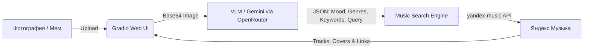

# 🎵 Vibe-to-Playlist


**Vibe-to-Playlist** — веб-приложение, которое превращает визуальную атмосферу ваших фотографий и мемов в музыкальные подборки из Яндекс Музыки.

Приложение считывает детали изображения, общую цветовую гамму, объекты и настроение (включая текстовые мемы) с помощью мультимодальной нейросети (VLM), формирует семантический запрос и автоматически подбирает треки с обложками альбомов.

---

## 🚀 Архитектура и Data Flow



1. **Gradio UI** принимает изображение и передаёт его в анализатор.
2. **VLM** (по умолчанию `google/gemini-3.6-flash` через OpenRouter) возвращает JSON: описание атмосферы на русском, 2–3 жанра, ключевые слова и поисковый запрос.
3. **Music Search** строит набор запросов (поисковая фраза → жанры → теги), ищет треки и убирает дубликаты.
4. Результат: описание вайба, галерея обложек и кликабельный список треков.

## 🛠 Стек

- **Gradio** — веб-интерфейс
- **OpenAI SDK** + **OpenRouter** — доступ к VLM (поддерживается и прямой OpenAI API)
- **yandex-music** — поиск треков
- **Pillow**, **python-dotenv**

## 📦 Установка

```bash
git clone https://github.com/<username>/Vibe-to-Playlist.git
cd Vibe-to-Playlist
python -m venv .venv
.venv\Scripts\activate        # Windows
# source .venv/bin/activate   # Linux / macOS
pip install -r requirements.txt
```

Скопируйте `.env.example` в `.env` и заполните ключи:

```env
OPENROUTER_API_KEY=sk-or-...     # или OPENAI_API_KEY=sk-...
YANDEX_MUSIC_TOKEN=...           # необязательно
```

Опционально:

```env
VLM_MODEL=google/gemini-3.6-flash
PLAYLIST_TRACK_LIMIT=10
GRADIO_SERVER_PORT=7860
```

## ▶️ Запуск

```bash
python app.py
```

Откройте в браузере адрес из вывода Gradio (по умолчанию `http://127.0.0.1:7860`).

## 📁 Структура

| Файл | Назначение |
|------|------------|
| `app.py` | Gradio UI и основной пайплайн |
| `src/vlm_analyzer.py` | Изображение → VLM → `VibeAnalysis` |
| `src/music_search.py` | `VibeAnalysis` → Яндекс Музыка → список `Track` |
